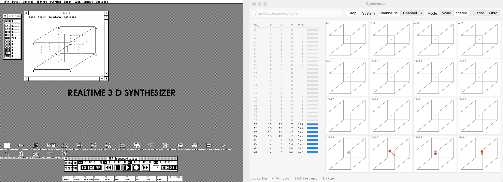

# Cybermove

A macOS monitor for the Cybermove MIDI output of
[Realtimer](https://github.com/zrhbert/realtimer) (RTM 4). Cybermove was
originally an Atari ST program, the standalone build of Realtimer's CMI and
CMO modules. This project shows the same kind of display on the Mac, fed by
the MIDI data Realtimer sends, either from Hatari or from an Atari connected
to the Mac through a MIDI interface.



Realtimer playing in Hatari (left) and Cybermove decoding its MIDI output live
(right, stereo mode). Signals 24 to 31 move; the other cubes show idle signals
at the centre.

Scope for now: **receive and display only.** The structure leaves room for
sending data back to the Atari later (see Design).

## Wire format

Taken from Realtimer's CMO module (`src/cmo.c`) and confirmed against a
capture of Realtimer playing in Hatari (`Tests/.../Fixtures/realtimer-play.bin`).

| Part | Meaning |
|---|---|
| Message | Note On |
| Channel | which CMI system (Realtimer defaults to MIDI channels 15 and 16) |
| Pitch | `signal * 4 + axis`, so 32 signals per system |
| Axis | 0 X, 1 Y, 2 Z, 3 volume |
| Velocity | the value; coordinates are `velocity - 64` (range -64 to +63), volume is raw |
| MIDI Stop | resets every coordinate and volume to zero |

Note Off, Clock and everything else are ignored, as in CMO. Velocity 0 is a
real value, not a note off. Realtimer sends every message with its own status
byte (no running status) and two Stop messages per stop.

## The app

`scripts/make-app.sh` builds `build/Cybermove.app` (add `--open` to start it): a real
app bundle with an icon, the identifier `io.github.zrhbert.Cybermove` and an ad-hoc
signature, which is enough to run it on the Mac that built it. `swift run Cybermove`
also works for quick tests, without the bundle. Distributing the app to other Macs
would need a Developer ID signature and notarization. The icon is drawn by
`scripts/make_icon.py` and the generated `Resources/AppIcon.icns` is committed.

The window: The left side lists the 32 signals of the
chosen system. The right side is a grid of cubes, each drawn as a true cube whatever the shape of its cell, laid out like Realtimer's CMO
window, in the same four graphics modes: mono (one signal per cube, a line from
the centre), stereo (pairs joined), quadro and okto (four or eight signals on
one line). The channel buttons choose which CMI system is shown.

The **Source** menu picks where the MIDI comes from:

| Source | Use |
|---|---|
| Hatari FIFO | Hatari writes its MIDI output into a FIFO that the app creates (`/tmp/cybermove.fifo`) |
| All MIDI inputs | every CoreMIDI input, for an Atari connected through a MIDI interface |
| a named input | one CoreMIDI input; the list follows plugging and unplugging |

The source, FIFO path and graphics mode are remembered between runs.

### Display options

The cubes are drawn by a real 3D camera that looks at the centre of the cube. All cubes
share the view. **Drag** in the cube area to turn them, **pinch** to zoom, **rotate** with two
fingers to twist about the line of sight, and **double-click** to return to the default view.
A small X, Y, Z indicator in the first cube shows how the view is turned.

The **Display** button opens the settings.

| Option | Effect |
|---|---|
| Yaw, Pitch, Roll | full rotation, -180 to 180 degrees each; pitch past 90 shows the cube from below and upside down |
| Perspective (field of view) | the lens angle: 0 is orthographic with no perspective, 30 is the default, 100 a strong wide angle. The cube keeps its size on screen, only the strength of the perspective changes |
| Zoom | scales the picture, relative to the fit below |
| Keep the whole cube in view | on by default: the picture is scaled so that the whole cube, from the current direction, fills its cell (with a 10% margin), and the zoom is relative to that. In the inside view the inside area is fitted the same way, so switching between the two views keeps the size and the zoom needs no adjusting. Off: a fixed size that is safe from every direction (a cube seen face-on then fills about 60% of the cell) |
| Presets | oblique, isometric, front, side, top and wide angle views |
| Inside view | zoom in on the middle third of the cube, like "Innenraum" |
| Mark the inside area | in the full view, a dotted square on each face shows what the inside view zooms in on |
| Lines between signals | the mono, stereo, quadro and okto lines |
| Crosshairs | a line along each axis through every point ("Fadenkreuz") |
| Volume bars | horizontal bars along the bottom of each cube |
| Signal numbers | the number beside each point that has data |
| Dot size follows volume | dots grow with the signal's volume |
| Nearer is larger and stronger | with perspective, nearer dots are larger and nearer edges darker |
| Axes indicator | the X, Y, Z indicator |

+z points towards the viewer, +x to the right and +y up when yaw, pitch and roll are 0.
The cube's sides are always drawn 1:1, whatever the shape of the cell. Parts of a line that
fall behind the camera (wide angles, inside view) are cut off. The inside view frames the
middle third of the cube with the same camera, and the cell cuts off what lies outside.

The settings, including the whole camera (angles, perspective, zoom, fit), are remembered between runs; Reset goes back to the defaults.

### Trying CoreMIDI without an Atari

`cybermove-midi-replay` plays a capture through a virtual MIDI source at the speed of
a real MIDI cable, so the app (or any other MIDI program) sees it like hardware:

```sh
swift run cybermove-midi-replay Tests/CybermoveCoreTests/Fixtures/realtimer-play.bin --loop
```

`cybermove-decode --list-midi` lists the inputs and `cybermove-decode --coremidi [id] --events`
prints what arrives on one of them.

## Try it with Hatari

Hatari needs a MIDI input as well, otherwise it disables MIDI completely. The
output FIFO blocks until a reader opens it, so start the decoder first.

```sh
mkfifo /tmp/cybermove.fifo
swift run cybermove-decode /tmp/cybermove.fifo --events &
hatari ... --midi-in /dev/null --midi-out /tmp/cybermove.fifo realtim5.prg
```

Only Hatari builds with MIDI file support take these options; the build in the
Atari ST Dev VS Code extension has none. Decode a recording instead with
`swift run cybermove-decode capture.bin`. Pass `--channels 14,15` to choose the
0-based channels of the two systems.

## Layout

| Path | Contents |
|---|---|
| `Sources/CybermoveCore` | MIDI parser, CMO-style decoder, camera and projection math, FIFO and CoreMIDI sources. No UI. |
| `Sources/CybermoveUI` | SwiftUI table, cube grid and the controller that follows a FIFO |
| `Sources/Cybermove` | the macOS app |
| `Sources/cybermove-decode` | command-line decoder for captures and live FIFOs |
| `Sources/cybermove-snapshot` | renders the window to a PNG from a capture, for checking the display (`--yaw --pitch --roll --fov --zoom`) |
| `Sources/cybermove-midi-replay` | plays a capture through a virtual CoreMIDI source |
| `Tests/CybermoveCoreTests` | parser and decoder tests, plus the real capture |

`swift test` runs everything.

## Design

The decoder only depends on a byte stream (`MidiByteSource`). The Hatari FIFO and
CoreMIDI are the two sources so far; CoreMIDI delivers Universal MIDI Packets, which
`UMP` converts back to classic MIDI bytes. A bidirectional port can later sit beside
them without touching the decoder.

## Roadmap

1. Core library and command-line decoder (done).
2. SwiftUI app with the coordinate table and the CMO-style cube grid (done).
3. CoreMIDI source for a physical connection (done; verified with a virtual source, not yet with a real interface).
4. A proper app bundle with an icon (done, `scripts/make-app.sh`); signing for distribution is not.
5. Display options from Realtimer's setup: a full-rotation perspective camera, crosshairs, volume bars (done); per-signal line switches are not.
6. Later: sending data to the Atari (transport, MMC, MTC position).
